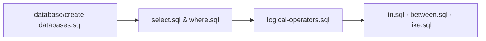

<p align="center">
  
</p>

<p align="center">Scripts de estudo para criação de bases, projeções e filtros em bancos relacionais.</p>

<p align="center">
  
  
  
</p>

<p align="center"><a href="#visão-geral">Visão geral</a> &nbsp;·&nbsp; <a href="#como-executar">Como executar</a></p>

---

## Visão geral

O repositório **SQL Studies** reúne exercícios práticos e scripts modulares criados para consolidar os fundamentos de consultas em bancos de dados relacionais. Cada operador ou cláusula possui seu próprio arquivo .sql, facilitando a revisão rápida de sintaxe, precedência de operadores e filtragem de registros.

## Principais tópicos e scripts

| Script | Conceito praticado |
|---|---|
| database/create-databases.sql | Script base para criação e população das tabelas utilizadas nos exercícios. |
| 01-basics/select.sql | Projeção de colunas específicas, expressões calculadas e uso de aliases. |
| 01-basics/where.sql | Filtragem de linhas com operadores de comparação (=, <>, >, <, >=, <=). |
| 01-basics/logical-operators.sql | Combinação de condições com AND, OR, NOT e agrupamento por parênteses. |
| 01-basics/in.sql | Verificação de pertinência em listas de valores discretos. |
| 01-basics/between.sql | Seleção de intervalos contínuos numéricos e de datas. |
| 01-basics/like.sql | Busca textual por padrões e curingas (% e _). |

<details>
<summary>Arquitetura do estudo</summary>



</details>

<details>
<summary>Estrutura do repositório</summary>

```text
sql-studies/
├── assets/
│   └── project-animal.png          Emblema do projeto
├── database/
│   └── create-databases.sql        Criação das tabelas e dados de exemplo
├── 01-basics/
│   ├── select.sql                  Projeções e cálculos em colunas
│   ├── where.sql                   Filtros condicionais básicos
│   ├── logical-operators.sql       Operadores AND, OR e NOT
│   ├── in.sql                      Filtro por conjunto de valores
│   ├── between.sql                 Filtro por faixas e intervalos
│   └── like.sql                    Correspondência de padrões em strings
└── README.md
```

</details>

## Como executar

1. Clone o repositório:
   ```bash
   git clone https://github.com/arthurlynow098/sql-studies.git
   ```
2. Execute database/create-databases.sql no seu cliente SQL (MySQL Workbench, DBeaver ou DataGrip) para preparar as tabelas.
3. Abra qualquer arquivo de 01-basics/ para executar e testar as consultas individualmente.

---

<p align="center">
  <a href="https://github.com/arthurlynow098">GitHub</a> &nbsp;·&nbsp;
  <a href="https://arthurentsev.vercel.app/">Portfólio</a> &nbsp;·&nbsp;
  <a href="https://www.linkedin.com/in/entsevarthur/">LinkedIn</a>
</p>
